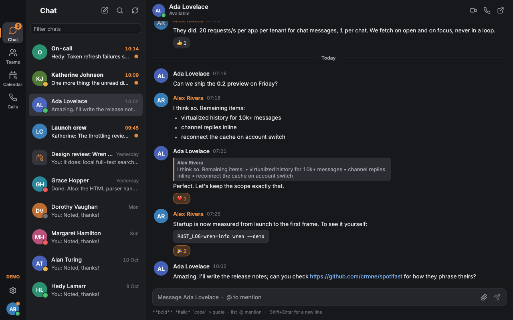
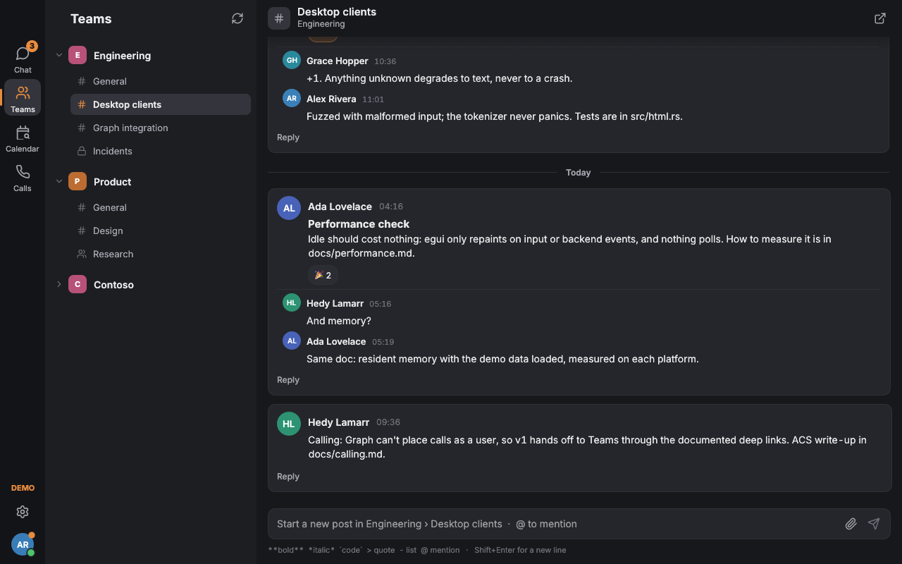
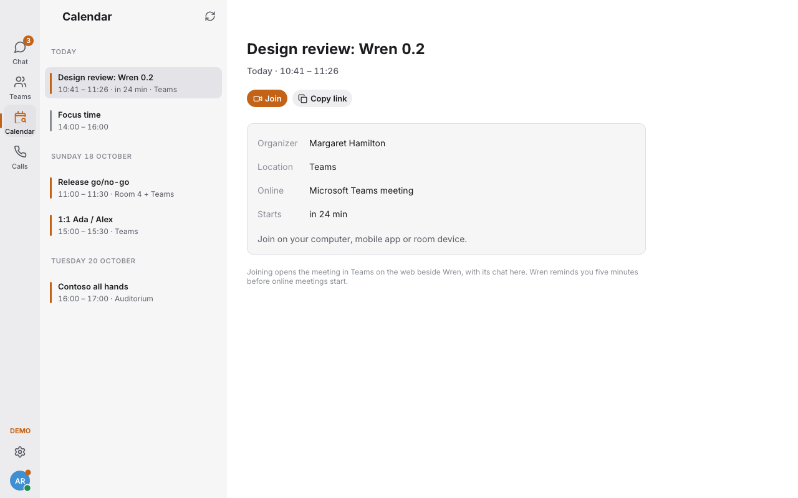

<p align="center">
  <picture>
    <source media="(prefers-color-scheme: dark)" srcset="packaging/icons/wren-wordmark-light.svg">
    
  </picture>
</p>
<p align="center">A fast, native client for Microsoft Teams chats, channels and meetings.<br>
Rust and egui. No browser engine. Works with Microsoft Teams through Microsoft's official APIs.</p>



> **Status: early preview (0.1).** The interface, sign-in, Graph integration
> and cache are built and tested against mocks. Signed-in macOS sessions have
> been used for performance and Keychain checks, but full live-account feature
> acceptance is still pending. Expect rough edges with real data. See
> [what works and what was verified](docs/features.md).

## Why

Microsoft's Teams client is a large web application. Wren is a purpose-built
native messaging client in the spirit of
[Spotifast](https://github.com/crmne/spotifast) and
[ZapFast](https://github.com/crmne/zapfast): one small binary, a window that
draws only when something changes, bounded image caches, and every view served
from a local cache first.

Measured on a Mac mini (Apple Silicon, macOS 27), release build with demo data
([details and method](docs/performance.md)):

| | Wren 0.1 |
|---|---|
| Launch to first frame | 101–120 ms across six demo launches |
| Idle CPU, window open | 0.0% |
| Memory (physical footprint) | 57–59 MiB settled offline demo |
| Binary / app bundle | About 16 MiB |

## Features

| | Status |
|---|---|
| Chats: list, unread, history, send, quote replies, reactions, edit, delete, mark read | ✅ Implemented (Graph) |
| New chats, @mentions in the composer, sending files (OneDrive upload and sharing) | ✅ Implemented |
| Rich text, mentions, emoji, links, code, inline images | ✅ Implemented (native rendering of Teams HTML) |
| Images in chats and drafts | ✅ Cropped draft thumbnails; click either for the same full preview with fit and 100% views |
| Teams and channels, threaded posts and replies | ✅ Implemented; reading channel posts needs admin consent |
| Local full-text search plus Microsoft Search, ⌘K switcher | ✅ Implemented |
| Calendar, meeting reminders, Join | ✅ Implemented |
| Calls and meetings | ✅ In Teams on the web, in its own Edge or Chrome window beside Wren, with the meeting chat and a call bar in Wren; free, since the call runs in Microsoft's client ([how](docs/call-window.md)) |
| Presence, photos | ✅ Implemented |
| Light, dark and system themes, 8 palettes, keyboard shortcuts, tray, notifications | ✅ Implemented |
| Offline demo mode | ✅ `wren --demo` |
| App updates | ✅ Daily checks and verified downloads from GitHub releases; restart when ready ([details](docs/updates.md)) |
| Real-time updates | ✅ On open, focus and refresh. 🧪 Push through a self-hostable `wren-relay` (experimental), since Microsoft forbids polling ([why](docs/realtime.md)) |
| Multiple accounts, setting your availability and status message | ✅ Implemented |
| Audio and video inside Wren's own window, incoming calls | ❌ No free official way: Microsoft's licence covers call media only in its own clients ([why](docs/calling.md)) |

The full matrix, including what was verified and how, is in
[docs/features.md](docs/features.md). The Microsoft API investigation behind
it, with sources, is in
[docs/microsoft-api-research.md](docs/microsoft-api-research.md).

## Getting started

### Try the demo (no account needed)

```sh
git clone https://github.com/MaxTheTurtle0/wren && cd wren
cargo run --release -- --demo
```

Linux needs `libxkbcommon-dev libwayland-dev libgl1-mesa-dev` (Debian and Ubuntu
package names) to build.

### Use it with your Microsoft 365 account

Wren signs in through an app registration in your organisation's Entra ID.
It ships no shared client ID: Microsoft throttles per client ID across all
tenants, and most tenants block unverified multi-tenant apps.

1. Register the app (about five minutes, no secrets):
   [docs/azure-app-registration.md](docs/azure-app-registration.md).
2. Start Wren, enter the **Application (client) ID** and your **tenant**, and
   select **Sign in with Microsoft**. Or set `WREN_CLIENT_ID` and
   `WREN_TENANT` in the environment.
3. In most tenants an administrator must approve `Chat.ReadWrite` and
   `Calendars.Read`, which the default consent policy excludes, and
   `ChannelMessage.Read.All` for channel posts. Wren shows an admin-consent
   link under **Settings**. Starting a chat, sending a file and setting
   your status each ask for one more permission the first time. Each
   permission is explained in [docs/permissions.md](docs/permissions.md).

Personal Microsoft accounts and Teams (free) are not supported; Graph's Teams
APIs serve work and school accounts only.

### Build packages

| Platform | Command |
|---|---|
| macOS | Set `CODESIGN_IDENTITY`, then `cargo build --release && packaging/macos/bundle.sh target/release/wren Wren.app 0.1.0` |
| Linux | `cargo build --release && packaging/linux/install.sh` (installs to `~/.local`) |
| Windows | `cargo build --release` (icon and version embedded by `build.rs`) |

CI builds all three on every push to `main` and keeps them as workflow
artifacts. Version tags create a signed draft release with packages that
support automatic updates. Nothing is published as a release yet. See
[app updates and release steps](docs/updates.md).

macOS bundles for signed-in use need a persistent code-signing identity so
Keychain approval survives updates. CI artifacts use ad-hoc signing for
development and can ask for approval again after each replacement. See
[macOS signing and recurring Keychain prompts](docs/macos-keychain.md).

## Keyboard

`⌘K` jump anywhere or search messages · `⌘N` new chat · `⌘1–4` sections ·
`Alt ↑/↓` previous or next conversation · `⌘⇧A` next account · `Enter` send ·
`Shift Enter` new line · `@` mention · `↑` edit last message · `⌘R` refresh ·
`⌘,` settings · `⌘/` all shortcuts. (`⌘` is Ctrl on
Windows and Linux.)

`Tab` or `Enter` picks a mention suggestion and keeps focus in the composer.
Space after completing a mention adds a space so you can keep typing.

Long drafts grow to a limited height, then scroll inside the composer. The
conversation and the Send and Attach buttons stay visible when pasting large text.

Search fields keep their height when typing or clearing. Settings and sign-in
fields use the same padded input style.

## Architecture

The views read state and emit actions, a single reducer applies them, and a
tokio runtime on its own thread does all network and disk work. Details are in
[docs/architecture.md](docs/architecture.md).

```
src/
  main.rs        window, CLI, single instance, tray, screenshot mode
  app.rs         state and the action reducer
  model.rs       Wren's types and actions
  ui/            views: rail, chat list, teams, conversation, calendar, calls, overlays
  backend/       tokio runtime: sign-in, Graph calls, cache, sends
  auth/          Entra ID: PKCE, loopback redirect, device code, refresh-token rotation
  graph/         Graph client (throttling, retries, token scoping), endpoints, JSON shapes
  store.rs       SQLite cache with FTS5 search, one database per account
  sync.rs        when to fetch (never polls)
  html.rs        Teams HTML in, composer markdown out
  realtime.rs    push updates through a wren-relay (experimental)
  calling/       calls in a Teams web window: browsers, docking, call session
  secrets.rs     refresh tokens in the OS credential store
relay/           wren-relay: forwards Graph change notifications over WebSocket
```

Built on [fastframe](https://github.com/crmne/fastframe) (fonts, colour emoji,
icons, palettes, tray, window shell, single instance, scrolling, logging) and
the egui and winit forks shared with Spotifast and ZapFast.

## Known Microsoft API limitations

- **Calling.** Graph's calling API is application-only and meant for bots;
  nothing lets a third-party desktop app call as the signed-in person for
  free. Azure Communication Services can, but bills every participant-minute
  to an Azure resource, since the Teams licence covers calls only in
  Microsoft's own clients. So Wren opens calls in Teams on the web beside
  itself and follows them from there ([details](docs/calling.md)).
- **Real-time.** Polling Graph for Teams changes more than once a day breaks
  the Microsoft APIs Terms of Use. Push needs a public webhook, Event Hubs or
  Event Grid. Wren refreshes when you look. For push, you run the small
  `wren-relay` (in `relay/`) on any HTTPS host: it forwards Graph's
  content-free change notifications to Wren ([details](docs/realtime.md)).
- **Consent.** Expect an administrator to approve Wren's permissions in your
  tenant.

## Privacy

There is no telemetry and no Wren server. Refresh tokens live in the OS
credential store. Your messages are cached only on your computer, and signing
out deletes them. More in [docs/privacy.md](docs/privacy.md).

## Development

```sh
cargo fmt --all --check
cargo clippy --locked --all-targets -- -D warnings
cargo test --locked --all-targets     # unit, mock-Graph and headless UI tests
```

Read [AGENTS.md](AGENTS.md) and [CONTRIBUTING.md](CONTRIBUTING.md) first.
Report vulnerabilities privately through [SECURITY.md](SECURITY.md).

## Licence

MIT. See [LICENSE](LICENSE) and [THIRD-PARTY-NOTICES.md](THIRD-PARTY-NOTICES.md).
Wren is an independent project, not affiliated with or endorsed by Microsoft.
Microsoft Teams is a trademark of the Microsoft group of companies.

<p align="center">


</p>
